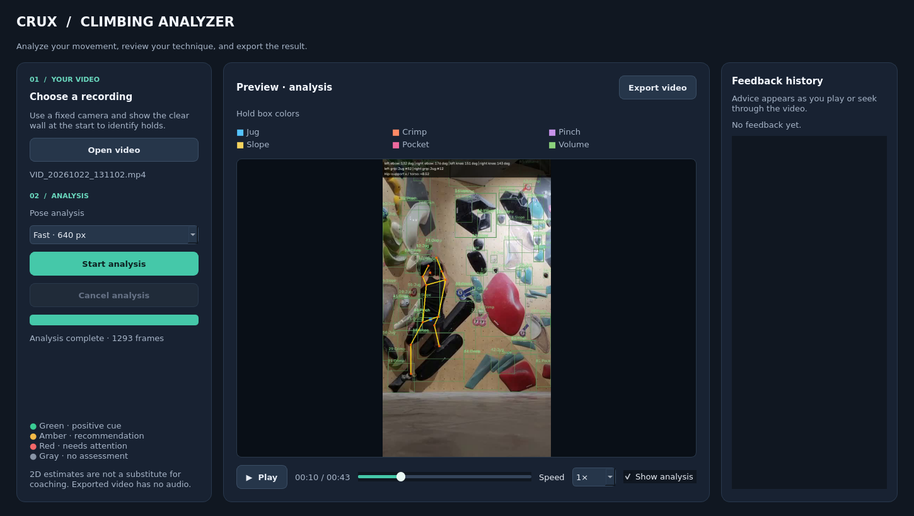
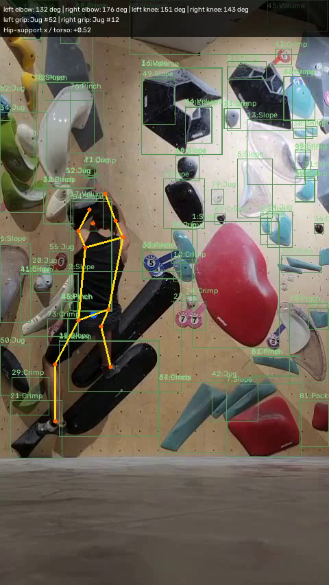
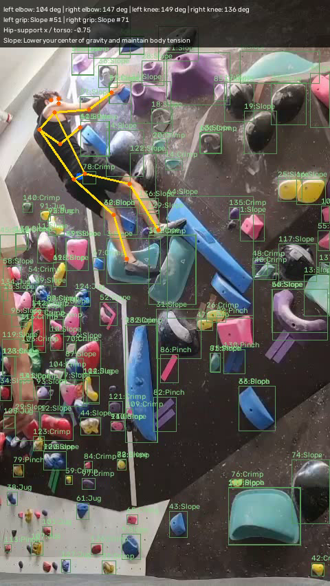

# Crux — Fixed-Camera Bouldering Video Analyzer

Crux analyzes a fixed-camera climbing video, detects holds, estimates a
climber's pose, and renders visual movement metrics and confidence-gated
coaching heuristics. Use the desktop app to preview and export a result, or
run the command-line analyzer directly.

> **Important:** This is an experimental 2D analysis tool, not professional
> coaching, a diagnosis, or a safety assessment. Green feedback does not
> certify correct technique or the absence of risk.

## Screenshots

The desktop screenshot shows a saved analyzed video in the player. These
existing video files do not contain the desktop app's session-only feedback
history, so the history panel is empty in this example.



Example frames extracted from two existing analyzed videos:

| Saved result · 00:10 | Saved result · 00:30 |
| --- | --- |
|  |  |

## Features

- Detect six hold categories: Jug, Crimp, Pinch, Pocket, Slope, and Volume.
- Track a climber's pose and show estimated joint angles, grip associations,
  and hip-to-support balance.
- Browse and seek through a video, compare the original with the analyzed
  preview, and export an annotated MP4 from the desktop app.
- Choose faster 640 px or more detailed 1024 px pose inference.
- Run analysis from the command line or optionally train a hold detector on
  the supported dataset.

## Requirements

- Python 3.10–3.12 recommended.
- Dependencies from [`requirements.txt`](requirements.txt), including
  Ultralytics, OpenCV, and PySide6.
- The desktop app expects these model files in `models/`:
  `best_holds.pt` and `yolov8m-pose.pt`. Model weights, datasets, and videos
  are not included in this repository; obtain or train the hold weights and
  provide the pose weights before using the app. Ultralytics can download
  `yolov8m-pose.pt`; place it in `models/` because the desktop app checks for
  that file there.

Create an environment and install dependencies:

```bash
python -m venv .venv
```

Activate it:

```bash
# Linux / macOS
source .venv/bin/activate
```

```powershell
# Windows PowerShell
.venv\Scripts\Activate.ps1
```

Then install the dependencies:

```bash
python -m pip install -r requirements.txt
```

Install PyTorch for the target platform if the dependency installation does
not select a compatible build for your CPU or GPU.

## Desktop app

Start the application from the project directory:

```bash
python -m app
```

On Linux or macOS, you can also run `.venv/bin/python -m app`; on Windows use
`.venv\Scripts\python -m app`.

1. Select a video recorded with a fixed camera and a clear view of the wall at
   the start.
2. Choose **Fast · 640 px** or **Detailed · 1024 px**, then click
   **Start analysis**. Processing runs in the background and can be cancelled.
3. Play or seek through the result, adjust playback speed from 0.25× to 2×,
   or toggle **Show analysis** to compare the original and analyzed video at
   the same position.
4. Click **Export video** to save the analyzed MP4. The temporary result is
   removed when the app closes, so export it if you want to keep it.

The desktop app shows English feedback in a history panel as playback reaches
new cues. A cue and its associated hold or holds must persist for at least
0.5 seconds; an interruption or hold change restarts that timer. The same cue
on the same hold or holds is suppressed for five seconds after it was last
shown. Seeking forward adds cues from the skipped interval, and seeking
backward does not remove history entries. The history resets when a new video
is selected or analyzed. Suppressing one cue does not block other eligible
cues.

Feedback borders indicate green (positive cue), amber (recommendation), and
red (needs attention). A red circle marks the hold associated with the current
cue in the analyzed preview and exported video. The original view has no
overlays or circle. Exported video does not retain audio, and playback speed
does not affect the exported file.

At the last frame, the app shows an overall recommendation. It groups raw
coaching signals by topic, including signals suppressed from individual
feedback, then selects the topic observed in the most frames. Simultaneous
signals about one topic count once per frame. Brief signals may be noisy; the
summary is not a diagnosis. Missing pose or hold evidence is distinguished
from a lack of detected signals, and neither indicates good technique.

### Hold and feedback colors

Hold category colors are separate from feedback severity. In the enhanced
video, hold overlays are blended with the image, so their displayed shades
vary with the background.

| Hold | Color |
| --- | --- |
| Jug | Light blue `#55c3ff` |
| Crimp | Coral `#ff8a65` |
| Pinch | Purple `#c792ea` |
| Slope | Yellow `#f4d35e` |
| Pocket | Pink `#ed6a9e` |
| Volume | Light green `#8bd17c` |

## Command-line analysis

Run the analyzer with a video:

```bash
python climbing_analyzer.py --video videos/originales/climbing.mp4
```

By default, the analyzer writes the wall map to
`videos/analizados/wall_map.json` and the annotated video to
`videos/analizados/climbing_analyzed.mp4`. The first 15 frames are used to map
the wall, after which the complete video is processed. The wall must remain
fixed and visible during mapping. Frame dimensions and frame rate must be
valid; audio is not copied.

The command-line pose inference defaults to 640 px. Use
`--pose-size 1024` for the more detailed setting; this changes inference size,
not output resolution or frame rate. Smaller inference images can miss or
shift landmarks and change feedback. Run `python climbing_analyzer.py --help`
for all options, including model paths and wrist tolerance.

## Optional: train the hold detector

Download and extract the
[Indoor Climbing Gym Hold Classification dataset](https://www.kaggle.com/datasets/diegospaziani/indoor-climbing-gym-hold-classification-dataset)
separately. The expected extracted dataset directory is
`data/Final_Dataset/`.

```bash
python train_holds.py --dataset data/Final_Dataset
```

Training saves run history under `artifacts/runs/detect/` and copies the best
weights to `models/best_holds.pt`. Initial YOLO weights may be downloaded
automatically by Ultralytics. Use `--device cpu` if needed; for CPU training,
`--cpu-threads 20` sets PyTorch's thread count after Ultralytics selects the
device. More threads are not necessarily faster and can make other
applications less responsive. Run `python train_holds.py --help` for options.

`data.yaml` uses the dataset's documented annotation IDs: Crimp, Jug, Pinch,
Pocket, Slope, and Volume. Confirm these against the specific dataset release
before training; changing names without remapping label IDs corrupts labels.

## How to interpret the results

Results are observational 2D image-space heuristics, **not** measured grip,
true center of mass, depth, contact, injury risk, or professional coaching.
Keypoints may be inaccurate; a wrist near a hold does not prove a grip, and
visible feet do not prove contact. A single climber is tracked using a simple
spatial continuity heuristic, so other people, occlusions, camera motion, and
missed holds can invalidate results. Inspect the saved map and output.

The hip midpoint is only a center-of-mass proxy. The lowest visible ankle(s)
are support-foot proxies, not confirmed foot contacts. Confidence-gated
missing landmarks suppress dependent metrics and cues instead of guessing.
Thresholds are illustrative starting points and have not been validated as
universal technique criteria:

- The Jug timer resets after the hip proxy rises by 0.1 torso lengths from its
  timer baseline.
- Crimp, Pinch, and Slope use a 0.35-torso horizontal balance threshold.
  Slope also flags a hip-to-support vertical separation above 1.25 torso
  lengths.
- Pocket acceleration is calculated from consecutive smoothed hip positions
  in torso lengths/s², with a threshold of 4.0; it is especially sensitive to
  frame rate and pose noise.
- Volume checks visible ankles against the expanded hold box and the hip
  against the support proxy. If either ankle is missing, the analyzer does not
  claim that neither foot is near the volume.
- A detected Pinch alone does not generate advice, and a bent elbow alone is
  not treated as proof of good Crimp technique.

Wrist proximity uses the hold bounding box plus `--wrist-margin` times the
shoulder-midpoint-to-hip-midpoint torso length (default `0.15`). A value of
`0` requires the wrist to be inside a box. Because both measurements are in
pixels, uniform resolution scaling does not require changing the ratio.
Increase it for noisier estimates (for example, `0.25`) or decrease it to
reduce false associations (for example, `0.05`). When multiple boxes match,
the closest normalized box center wins.

## Project layout

```text
app/                  Desktop interface and video player
climbing/             Hold mapping, pose, coaching, and rendering
tests/                Unit tests
climbing_analyzer.py  Video analysis and command-line entry point
train_holds.py        Optional hold-detector training script
data.yaml             Dataset class configuration
requirements.txt      Python dependencies
docs/images/          README screenshots
```

Datasets, model weights, source and analyzed videos, training artifacts,
logs, and Python environments are local assets and are excluded from Git.
See [`.gitignore`](.gitignore).

## Tests

Run the test suite from the project directory:

```bash
python -m unittest discover -s tests -v
```
